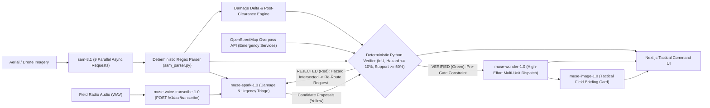
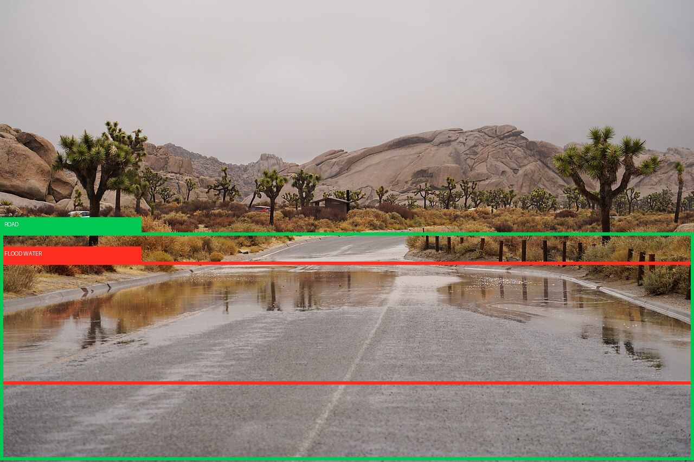
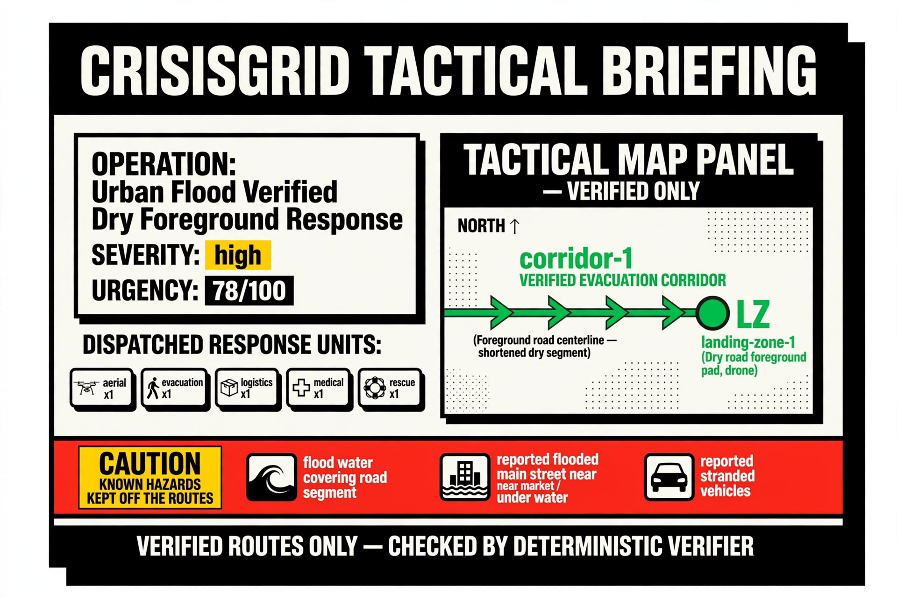

<div align="center">

# CrisisGrid

### Autonomous Multimodal Disaster Triage, Infrastructure Assessment & Verified Emergency Dispatch Agent

[](./LICENSE)
[](https://www.python.org/)
[](https://fastapi.tiangolo.com/)
[](https://nextjs.org/)
[](./backend/README.md)
[](https://api.meta.ai)

**`sam-3.1` Spatial Segmentation** · **`muse-voice-transcribe-1.0` Radio ASR** · **`muse-spark-1.3` Multimodal Triage**  
**Deterministic Python Verifier + OSM** · **`muse-wonder-1.0` High-Effort Dispatch** · **`muse-image-1.0` Tactical Briefing Cards**

[Overview](#-overview) · [Architecture](#%EF%B8%8F-system-architecture) · [Model Specifications](#-meta-model-pipeline--specifications) · [Verification Engine](#-deterministic-verification-engine) · [Visual Proof & Presets](#-visual-proof--disaster-presets) · [Quick Start](#-quick-start) · [API Reference](#-api-reference) · [Author](#-author)

</div>

---

## 🌍 Overview

When floods, earthquakes, wildfires, or landslides strike, emergency operations centers face severe latency aggregating aerial imagery, noisy field-responder radio calls, and static road maps before establishing safe rescue routes. Standard vision-language models frequently propose evacuation corridors that traverse hazardous terrain—such as floodwaters, compromised bridges, or active debris fields—because they lack geometric grounding.

**CrisisGrid** resolves this by decoupling neural proposal from deterministic verification. Built using the **official Meta Model API (`https://api.meta.ai/v1`)** authenticated via a single `MODEL_API_KEY` and anchored by a **local Python geometry verification engine**, CrisisGrid provides:

1. **Multimodal Ingestion:** Ingests aerial, drone, or ground imagery alongside emergency responder radio transmissions (`muse-voice-transcribe-1.0`) or textual dispatch logs.
2. **Parallel Spatial Segmentation:** Executes parallel, single-phrase segmentation requests via `sam-3.1` across 9 hazard and infrastructure concepts, parsed by a deterministic regex engine.
3. **Multimodal Triage & Candidate Proposals:** Evaluates incident severity and proposes candidate evacuation corridors and landing zones using `muse-spark-1.3`.
4. **Deterministic Mathematical Verification:** Evaluates candidate corridors against hazard masks using pure local Python (`verifiable_corridor_engine.py`). Computes exact Intersection-over-Union (IoU), corridor hazard contact ratios ($\le 10\%$), passable infrastructure support ($\ge 50\%$), landing zone pixel clearance, and OpenStreetMap Overpass emergency facility proximity. If a candidate path intersects a hazard by $>10\%$, the verifier rejects it with geometric proof and forces a bounded re-routing loop.
5. **High-Effort Dispatch & Tactical Briefings:** Coordinates multi-unit emergency response protocols via `muse-wonder-1.0` (`reasoning={"effort": "high"}`) and synthesizes visual field briefing schematics via `muse-image-1.0`, strictly constrained to verified infrastructure.

> **Safety Invariant:** Model outputs serve exclusively as *proposals* (rendered in yellow); pure Python geometry acts as the *verifier* (rendered in green for verified, red for rejected). No unverified route is ever approved for dispatch.

---

## 🏗️ System Architecture

### 1. End-to-End Pipeline



### 2. Closed-Loop Verification Sequence

```mermaid
sequenceDiagram
    autonumber
    actor Operator as Emergency Dispatcher
    participant UI as Next.js Tactical UI
    participant API as FastAPI Backend
    participant SAM as sam-3.1
    participant ASR as muse-voice-transcribe-1.0
    participant Spark as muse-spark-1.3
    participant Verifier as verifiable_corridor_engine.py
    participant Wonder as muse-wonder-1.0
    participant Image as muse-image-1.0

    Operator->>UI: Submit Scene Imagery + Radio WAV
    UI->>API: POST /api/run-crisisgrid
    par Parallel Spatial Segmentation (9 Concepts)
        API->>SAM: 9x async POST /v1/responses (single phrase per call)
        SAM-->>API: Bounding boxes and RLE mask data
    and Radio Transcription
        API->>ASR: POST /v1/asr/transcribe (16kHz mono s16le WAV)
        ASR-->>API: Decoded emergency field radio transcript
    end
    API->>API: Parse boxes and masks via regex; strip raw RLE for prompt
    API->>Spark: Transcripts + Image + Grounded Spatial Summary
    Spark-->>API: Urgency Score + Candidate Corridors & LZs (status: unverified_candidate)
    API->>Verifier: Evaluate candidates against hazard & infrastructure masks
    alt Candidate Hazard Contact > 10% or Support < 50%
        Verifier-->>API: REJECTED + Exact geometric proof (IoU, collision coordinates)
        API->>Spark: Bounded Re-Route Request with Verifier Collision Data (max 2 attempts)
        Spark-->>API: Revised Corridor & Landing Zone Coordinates
        API->>Verifier: Re-evaluate revised coordinates (pure Python math)
    end
    Verifier-->>API: VERIFIED Candidates (status: verified)
    API->>Wonder: Pre-gated verified geometry -> muse-wonder-1.0 (reasoning: high)
    Wonder-->>API: Multi-unit dispatch protocol (checked by post-generation guardrail)
    API->>Image: Facts-only prompt -> muse-image-1.0
    Image-->>API: Generated Tactical Briefing Card PNG
    API-->>UI: Complete Mission State + Verifiable Agent Trace
```

---

## 🧠 Meta Model Pipeline & Specifications

CrisisGrid communicates directly with the Meta Model API at `https://api.meta.ai/v1` via standard OpenAI-compatible HTTP requests, authenticated by `MODEL_API_KEY`.

| Model | Primary Function | Endpoint / Method | Contract & Guardrail Details | Implementation |
| :--- | :--- | :--- | :--- | :--- |
| **`sam-3.1`** | Spatial Hazard & Infrastructure Segmentation | `POST /v1/responses`<br/>(`client.responses.create`) | **Single noun phrase per request.** 9 concepts dispatched asynchronously in parallel via `asyncio.gather`. Parsed exclusively via compiled regex ([`sam_parser.py`](./backend/services/sam_parser.py)). | [`sam_hazard_scanner.py`](./backend/services/sam_hazard_scanner.py) |
| **`muse-voice-transcribe-1.0`** | Field Radio Voice Transcription | `POST /v1/asr/transcribe`<br/>(`multipart/form-data`) | Audio validated locally before dispatch (`16000` / `24000` Hz mono `s16le` PCM). Includes typed-text fallback for silent environments. | [`voice_and_triage.py`](./backend/services/voice_and_triage.py) |
| **`muse-spark-1.3`** | Multimodal Triage & Self-Correction Re-Routing | `POST /v1/responses`<br/>(`role="developer"`) | Fuses radio transcript, image frame, and mask-stripped spatial summaries into structured JSON triage plans and candidate geometry. Re-routes rejected corridors on geometric failure evidence. | [`voice_and_triage.py`](./backend/services/voice_and_triage.py)<br/>[`verifiable_corridor_engine.py`](./backend/services/verifiable_corridor_engine.py) |
| **`muse-wonder-1.0`** | High-Effort Dispatch Coordination | `POST /v1/responses`<br/>(`reasoning={"effort":"high"}`) | Pre-gated to accept **only verified geometry**. Secondary Python guardrail audits output, holding any unit assigned to unverified targets. | [`wonder_commander.py`](./backend/services/wonder_commander.py) |
| **`muse-image-1.0`** | Tactical Field Briefing Card Synthesis | `POST /v1/images/generations`<br/>(`output_format="png"`) | Prompts are deterministically constructed in Python from verified parameters only, preventing hallucinated hazard depictions. | [`wonder_commander.py`](./backend/services/wonder_commander.py) |

### Open-Weight & Self-Hosted Model Support

CrisisGrid is compatible with self-hosted open-weight reasoning models (**`muse-spark-open`** and **`muse-glimmer`**) served through standard OpenAI-compatible inference servers (vLLM, Ollama, SGLang, TGI) or partner endpoints:

```bash
# Configure self-hosted open-weight triage model:
export TRIAGE_MODEL="muse-spark-open"               # or "muse-glimmer"
export META_API_BASE_URL="http://localhost:8000/v1"     # local or partner inference endpoint
export MODEL_API_KEY="EMPTY"                        # dummy key accepted for local runtimes
```

Runtime compatibility and health verification can be queried at [`GET /health`](./backend/main.py).

---

## 🛡️ Deterministic Verification Engine

All geometric verification, change detection, and sector prioritization execute in pure local Python with zero model dependencies ([`verifiable_corridor_engine.py`](./backend/services/verifiable_corridor_engine.py) and [`damage_delta.py`](./backend/services/damage_delta.py)):

### 1. Corridor Hazard Contact Ratio ($\le 10\%$)
$$R_{\text{hazard}}(C) = \frac{L\left(C \cap \bigcup_{h \in \mathcal{H}} h\right)}{L(C)} \le 0.10$$
Evaluated via pixel-level mask decoders or exact Liang-Barsky parametric line-box clipping. Corridors with $>10\%$ hazard contact are rejected with bounding-box collision proofs.

### 2. Infrastructure Support Ratio ($\ge 50\%$)
$$R_{\text{support}}(C) = \frac{L\left(C \cap \bigcup_{s \in \mathcal{S}} s\right)}{L(C)} \ge 0.50$$
Verifies that candidate evacuation corridors align with structurally viable surfaces (`road`, `bridge`, `clear flat ground`, `rooftop`).

### 3. Landing Zone Clearance
Helicopter landing zones require normalized radius $r \ge 0.040 \cdot \min(W, H)$, hazard overlap $\le 10\%$, and safe-surface overlap $\ge 50\%$. Drone landing zones require $r \ge 0.015 \cdot \min(W, H)$.

### 4. Multi-Sector Priority Scoring
Ranks competing operational zones deterministically on a $0\text{–}100$ scale:
$$\text{Score} = 0.40 \cdot \text{Urgency} + \text{Severity}_{\le 25} + \text{PeopleAtRisk}_{\le 15} + \text{HazardFootprint}_{\le 10} + \text{AccessPressure}_{\le 10}$$

---

## 📸 Visual Proof & Disaster Presets

Below is an end-to-end execution of the Urban Flood scenario ([`live-flood.jpg`](./live-flood.jpg) + [`radio-report.wav`](./radio-report.wav)):

| 1. Raw Input Frame | 2. SAM-3.1 Segmentation Overlay | 3. Muse-Image-1.0 Verified Briefing Card |
| :---: | :---: | :---: |
|  |  |  |
| *Input drone frame + responder radio WAV* | *Green `ROAD` vs. Red `FLOOD WATER`* | *Synthesized strictly from verified corridor data* |

### Built-in Global Disaster Presets

CrisisGrid includes preset scenarios representing major disaster profiles. Presets provide raw inputs (imagery, radio audio, coordinates); all segmentations and dispatch plans are computed live:

| Preset | Scenario Profile | Canonical Target Concepts |
| :--- | :--- | :--- |
| **`urban-flood`** | Monsoon / flash flood urban corridor | `flood water`, `road`, `bridge`, `rooftop`, `stranded vehicle` |
| **`earthquake-bridge`** | Seismic bridge collapse & rubble triage | `debris`, `damaged building`, `bridge`, `clear flat ground`, `road` |
| **`wildfire-helipad`** | Wildfire perimeter & evacuation landing zone | `fire`, `road`, `clear flat ground`, `rooftop`, `debris` |

---

## ⚡ Quick Start

### 1. Clone & Configure Environment

```bash
git clone https://github.com/Sameer769dev/CrisisGrid.git
cd CrisisGrid

cp .env.example .env
# Set your Meta Model API key in .env:
# MODEL_API_KEY=your_key_here
```

### 2. Run the Offline Test Suite (236/236 Assertions Passing)

The complete verification suite runs locally without requiring an API key or external network access:

```bash
pip install -r backend/requirements.txt

python backend/test_meta_api.py                    # Regex parser & box IoU (7 assertions)
python backend/test_sam_hazard_scanner.py          # Parallel 9-concept scanner (18 assertions)
python backend/test_voice_and_triage.py            # WAV validator, ASR & Spark triage (38 assertions)
python backend/test_verifiable_corridor_engine.py  # Geometry verifier & re-route loop (48 assertions)
python backend/test_wonder_commander.py            # Dispatch guardrails & briefing generator (55 assertions)
python backend/test_damage_delta.py                # Damage delta, clearance & sector rank (24 assertions)
python backend/test_presets.py                     # Disaster preset catalogue integrity (25 assertions)
python backend/test_usgs_and_modal.py              # USGS live telemetry & serverless runtime (21 assertions)
```

### 3. Launch the Application

**Terminal 1 — FastAPI Backend:**
```bash
uvicorn backend.main:app --reload --port 8000
```
*API documentation available at `http://localhost:8000/docs`.*

**Terminal 2 — Next.js Tactical UI:**
```bash
cd frontend
cp .env.local.example .env.local
npm install
npm run dev
```
*Mission Control dashboard accessible at `http://localhost:3000`.*

### 4. Video Demonstration & Walkthrough

A structured 3-minute technical walkthrough script covering each operational stage is available in [`docs/DEMO_SCRIPT.md`](./docs/DEMO_SCRIPT.md).

---

## 🔌 API Reference

| Method | Endpoint | Description |
| :---: | :--- | :--- |
| `GET` | `/health` | Service version, model map, and configuration status. |
| `POST` | `/api/sam/parse` | Offline deterministic regex parser for `sam-3.1` output format. |
| `POST` | `/api/scan-hazards` | Parallel async `sam-3.1` multi-concept hazard segmentation. |
| `POST` | `/api/triage` | Multipart audio/text triage using `muse-voice-transcribe-1.0` + `muse-spark-1.3`. |
| `POST` | `/api/verify` | Pure Python geometry verification + OpenStreetMap facility lookup. |
| `POST` | `/api/dispatch` | High-effort `muse-wonder-1.0` multi-unit dispatch + `muse-image-1.0` card synthesis. |
| `POST` | `/api/run-crisisgrid` | Unified single-call pipeline executing scan, triage, verify, and dispatch. |
| `POST` | `/api/delta` | Greedy per-concept IoU change detection between before/after disaster scans. |
| `POST` | `/api/delta/verify-clearance`| Re-verifies routes against post-clearance imagery without model inference. |
| `POST` | `/api/sectors/rank` | Deterministic $0\text{–}100$ multi-sector priority ranking. |
| `GET` | `/api/presets` | Retrieval of built-in global disaster test presets. |
| `GET` | `/api/usgs/live` | Ingestion of live M4.5+ earthquake telemetry from USGS. |

### Single-Call Pipeline Example via `curl`

```bash
curl -sS -X POST http://localhost:8000/api/run-crisisgrid \
  -F "image=@live-flood.jpg" \
  -F "audio=@radio-report.wav" \
  -F "latitude=27.7172" \
  -F "longitude=85.3240" \
  -F "auto_correct=true" \
  -F "include_briefing_card=true" > mission_result.json
```

---

## 📂 Repository Structure

```text
CrisisGrid/
├── AGENTS.md                        # Architectural constraints & Meta Model API rules
├── ROADMAP.md                       # Engineering build log & phased milestone documentation
├── README.md                        # Technical documentation & usage guide
├── SECURITY.md                      # Security policy & credential isolation architecture
├── LICENSE                          # MIT License
├── live-flood.jpg                   # Sample urban flood scenario image
├── live-flood-overlay.png           # SAM-3.1 segmentation output
├── live-flood-briefing-card.png     # Muse-Image-1.0 generated briefing card
├── radio-report.wav                 # 16kHz mono PCM emergency responder radio recording
├── docs/
│   ├── ARCHITECTURE.md              # Deep-dive system specification & mathematical proofs
│   ├── DEMO_SCRIPT.md               # 3-minute technical demonstration script
│   └── TIMECODE_EDITING_GUIDE.md    # Video timeline & editing reference
├── backend/
│   ├── main.py                      # FastAPI application router & endpoints
│   ├── config.py                    # Environment configuration & OpenAI SDK client
│   ├── modal_app.py                 # Modal serverless CPU deployment configuration
│   ├── requirements.txt             # Python runtime dependencies
│   ├── test_*.py                    # 8 offline verification test suites (236 assertions)
│   └── services/
│       ├── sam_parser.py            # Regex parser for sam-3.1 output format
│       ├── sam_hazard_scanner.py    # Parallel single-phrase SAM segmentation engine
│       ├── voice_and_triage.py      # Radio transcription & multimodal triage
│       ├── verifiable_corridor_engine.py # Deterministic geometry verifier & OSM lookup
│       ├── wonder_commander.py      # High-effort dispatch & briefing generator
│       ├── damage_delta.py          # Damage delta, clearance verification & sector ranker
│       └── presets.py               # Disaster scenario preset loader
└── frontend/
    ├── package.json                 # Next.js 14, TypeScript & Tailwind CSS dependencies
    ├── app/                         # App Router pages and styling
    ├── components/                  # TacticalCanvas, AgentTrace, DispatchConsole
    └── lib/                         # Typed API client and helper utilities
```

---

## 👤 Author

**Samir Baral**  
Full-Stack & Android Developer • Nepal 🇳🇵  
- **GitHub:** [@Sameer769dev](https://github.com/Sameer769dev)  
- **Email:** [baralsamir941@gmail.com](mailto:baralsamir941@gmail.com)  

---

## 📄 License

This project is licensed under the [MIT License](./LICENSE).
