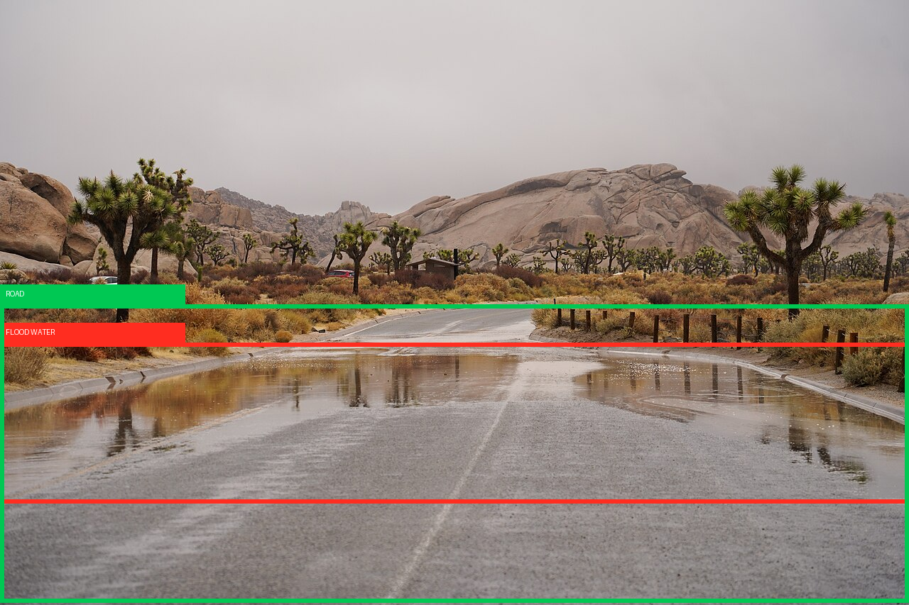
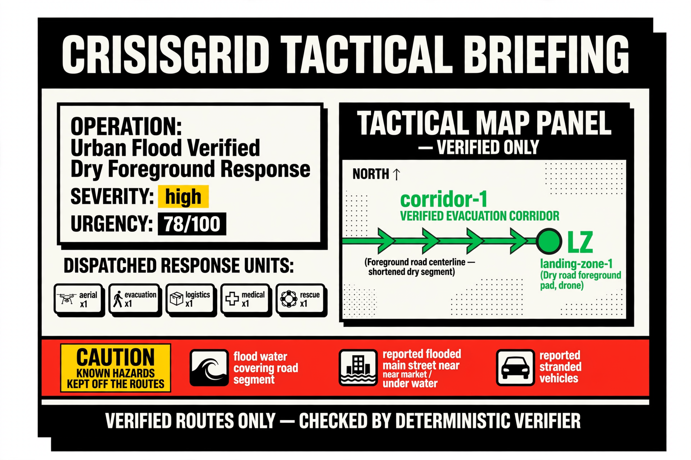
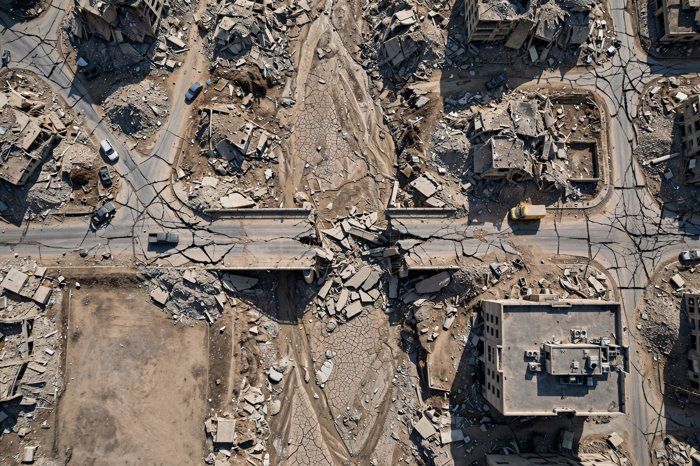
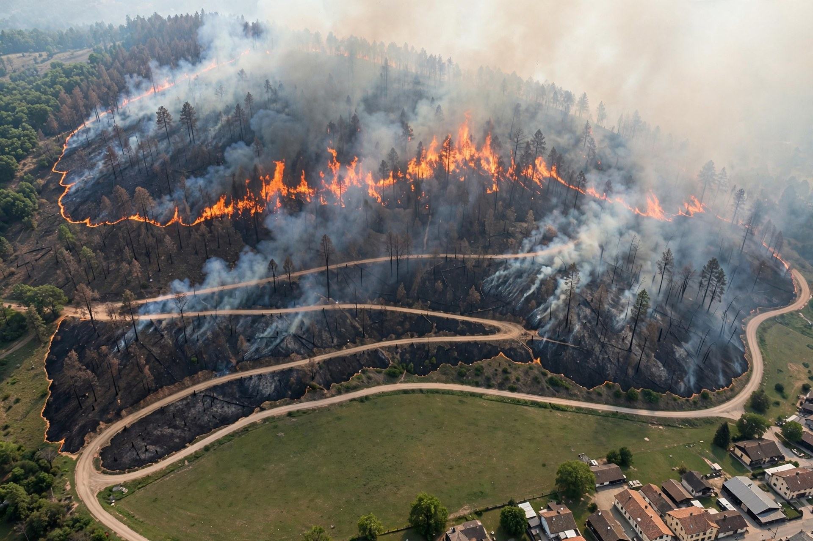
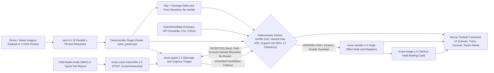
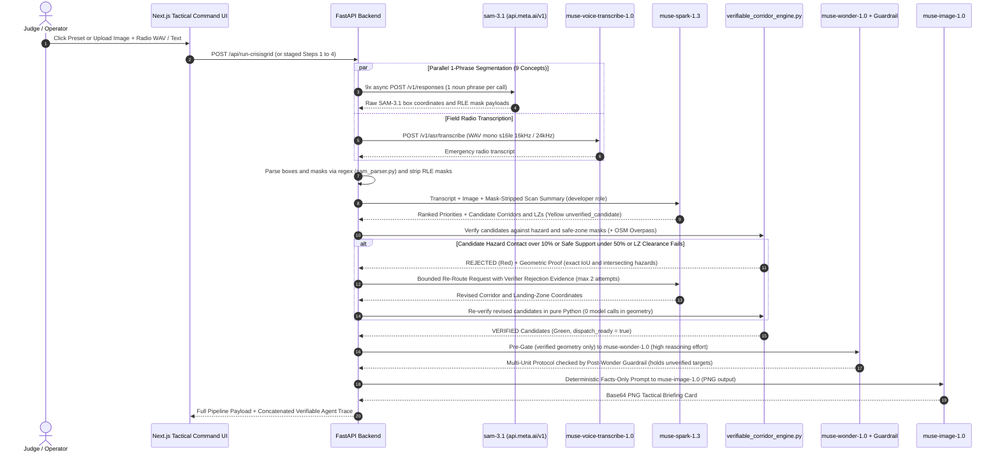
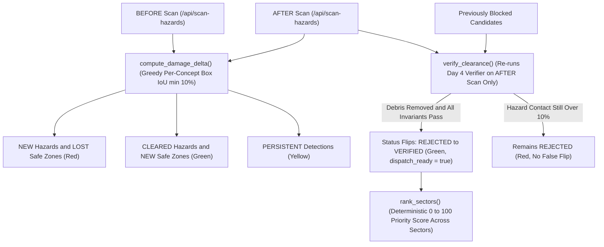

<div align="center">

# CrisisGrid

### Autonomous Multimodal Disaster Triage, Infrastructure Assessment & Verifiable Emergency Dispatch Agent

[](https://github.com/Sameer769dev/CrisisGrid)
[-00C853?style=for-the-badge)](./AGENTS.md)
[](./backend/services/verifiable_corridor_engine.py)
[](./backend/README.md)
[](./LICENSE)

**`sam-3.1` Parallel Segmentation** · **`muse-voice-transcribe-1.0` Radio ASR** · **`muse-spark-1.3` Multimodal Triage & Re-Route** · **Deterministic Python Verifier + OSM** · **`muse-wonder-1.0` High-Effort Dispatch** · **`muse-image-1.0` Tactical Briefing Cards**

[Why CrisisGrid](#-why-crisisgrid-wins) · [Visual Proof](#-end-to-end-visual-proof-disaster-in--verified-corridor--autonomous-dispatch-out) · [Architecture Diagrams](#️-system-architecture-mermaid-diagrams) · [All 5 Meta Models](#-full-breakdown-of-all-5-meta-models-used-httpsapimetaiav1) · [Verifiable-Agent Math](#️-the-verifiable-agent-principle-spark-proposes-python-disposes) · [⏱️ 3-Min Demo Script](#️-timed-3-minute-live-demo-script-for-judges) · [Quick Start](#-quick-start-clone-to-demo-in-under-5-minutes) · [API Reference](#-complete-api-reference)

</div>

---

## 🌍 Problem & Executive Vision

When floods, earthquakes, wildfires, or landslides strike anywhere in the world, emergency operations centers lose **45+ critical minutes** manually cross-referencing aerial/drone imagery, noisy field-responder radio calls, and static road maps before they can safely route rescue units. Worse, off-the-shelf vision-language models routinely hallucinate "safe" evacuation routes straight through floodwater, collapsed bridges, or active debris fields.

**CrisisGrid** closes that gap without ever trusting an unverified neural guess. Built **100% on the official Meta Model API (`https://api.meta.ai/v1`)** authenticated with a single `MODEL_API_KEY` and paired with a **deterministic local Python geometry verifier**, CrisisGrid:

1. **Ingests** aerial, drone, or street-level disaster imagery alongside spoken field-responder radio reports (`muse-voice-transcribe-1.0`) or typed operator reports.
2. **Segments** physical hazards vs. passable infrastructure using parallel, single-phrase `sam-3.1` requests parsed by a zero-LLM deterministic regex engine (`sam_parser.py`).
3. **Proposes** ranked triage priorities, candidate evacuation corridors, and helicopter/drone landing zones via multimodal reasoning (`muse-spark-1.3`).
4. **Mathematically Verifies** every candidate corridor and landing zone in pure local Python (`verifiable_corridor_engine.py`)—computing exact RLE-mask or bounding-box Intersection-over-Union (IoU), route hazard-contact ratios ($\le 10\%$), safe-surface support ($\ge 50\%$), pixel clearance radii, and live **OpenStreetMap Overpass API** emergency facility distances. **If a proposed path crosses a segmented hazard mask by $>10\%$, the verifier rejects it with geometric proof and forces `muse-spark-1.3` into a bounded self-correction re-route loop.**
5. **Dispatches** multi-unit rescue protocols (`muse-wonder-1.0` with `reasoning={"effort": "high"}`) and generates visual tactical field briefing cards (`muse-image-1.0`) strictly from **mathematically verified** state—enforced by both pre-prompt and post-generation deterministic Python guardrails.

> [!IMPORTANT]
> **Core Safety Invariant:** Model output is always a *proposal* (`#FFD600` Yellow); deterministic local Python code is the *verifier* (`#00C853` Green / `#FF2D20` Red). No unverified route is ever marked safe or passed to autonomous dispatch.

---

## 🏆 Why CrisisGrid Wins

| Judging Dimension | Why It Matters | How CrisisGrid Delivers |
| :--- | :--- | :--- |
| **1. Universal Global Impact** | Floods, wildfires, and earthquakes affect every continent. Nobody needs local cultural context to immediately grasp why saving 45 minutes during emergency triage saves lives. | Operates on any aerial, drone, or street-level frame worldwide, enriched by global **OpenStreetMap Overpass API** hospital, clinic, fire, and police station lookups whenever GPS coordinates are supplied. |
| **2. Impossible to Call a "Simple Image Analyzer"** | A single VLM prompt wrapper cannot safely coordinate multi-unit disaster response or certify physical route geometry. | Combines **all 5 Meta frontier modalities** (`sam-3.1`, `muse-voice-transcribe-1.0`, `muse-spark-1.3`, `muse-wonder-1.0`, `muse-image-1.0`) with a **zero-LLM deterministic geometric verifier**, closed-loop self-correction, before/after damage delta, and multi-sector triage ranking. |
| **3. Zero Need to Film Local Footage** | Judges can run the full pipeline in 1 click without custom hardware or regional footage. | Ships with **3 pre-loaded 1-click global disaster presets** (Urban Flood Corridor, Earthquake Bridge & Rubble Triage, Wildfire Evacuation & Helipad Finder), real emergency radio WAV audio, and a clean text fallback. |

---

## 📸 End-to-End Visual Proof: Disaster In → Verified Corridor → Autonomous Dispatch Out

Below is an actual live end-to-end run on the repository's Urban Flood scenario ([`live-flood.jpg`](./live-flood.jpg) + [`radio-report.wav`](./radio-report.wav)):

1. **`sam-3.1`** segments passable `ROAD` (`#00C853` Green) vs. blocking `FLOOD WATER` (`#FF2D20` Red) across the midground (`y: 0.56 → 0.83`).
2. **`muse-spark-1.3`** initially proposes a corridor that reaches into the flooded road span; **`verifiable_corridor_engine.py`** rejects it (`hazard_intersection_ratio > 0.10`) and forces a self-correction re-route onto the dry foreground road segment (`corridor-1`) and dry foreground pad (`landing-zone-1`).
3. **`muse-wonder-1.0`** (`reasoning={"effort": "high"}`) dispatches 5 response units onto the verified targets (`0` held by the guardrail), and **`muse-image-1.0`** renders the tactical briefing schematic strictly from verified facts:

| 1. Raw Disaster Input ([`live-flood.jpg`](./live-flood.jpg)) | 2. Parallel `sam-3.1` Segmentation ([`live-flood-overlay.png`](./live-flood-overlay.png)) | 3. `muse-image-1.0` Verified Briefing Card ([`live-flood-briefing-card.png`](./live-flood-briefing-card.png)) |
| :---: | :---: | :---: |
|  |  |  |
| *Input frame + spoken radio WAV (`radio-report.wav`)* | *Green `ROAD` vs. Red `FLOOD WATER` (`sam-3.1`)* | *Generated strictly from verified `corridor-1` & `landing-zone-1`* |

### 1-Click Global Judge Presets (`GET /api/presets` + Mission Control UI)

Every preset loads real inputs (imagery + radio WAV/text report + GPS coordinates) with **zero pre-baked detections or canned results**—clicking **RUN** executes the live Meta Model API pipeline:

| Preset 1: `urban-flood` | Preset 2: `earthquake-bridge` | Preset 3: `wildfire-helipad` |
| :---: | :---: | :---: |
|  |  |  |
| **Urban Flood Corridor** (`urban-flood.jpg` + `field-radio.wav`)<br/>*Focus:* `flood water`, `road`, `bridge`, `rooftop`, `stranded vehicle` | **Earthquake Bridge & Rubble Triage** (`earthquake-bridge.jpg`)<br/>*Focus:* `debris`, `damaged building`, `bridge`, `clear flat ground`, `road` | **Wildfire Evacuation & Helipad Finder** (`wildfire-helipad.jpg`)<br/>*Focus:* `fire`, `road`, `clear flat ground`, `rooftop`, `debris` |

---

## 🏗️ System Architecture (Mermaid Diagrams)

### 1. End-to-End Multimodal Pipeline (Synced with [`ROADMAP.md`](./ROADMAP.md))



### 2. Closed-Loop Verification & Double-Guardrail Dispatch Sequence



### 3. Day 7 Before/After Damage Delta, Post-Clearance Flip & Multi-Sector Triage



---

## 🧠 Full Breakdown of All 5 Meta Models Used (`https://api.meta.ai/v1`)

CrisisGrid uses **100% official Meta Model API inference (`https://api.meta.ai/v1`)** via a single `MODEL_API_KEY`. No OpenAI, Anthropic, Google, Replicate, or third-party cloud GPU endpoints exist anywhere in the codebase. The OpenAI Python SDK is used strictly as an HTTP client pointed at `base_url="https://api.meta.ai/v1"`.

| # | Meta Model ID | Role in CrisisGrid | Endpoint / SDK Method | Wire Contract & Guardrails | Implementation |
| :-: | :--- | :--- | :--- | :--- | :--- |
| **1** | **`sam-3.1`** | Pixel-precise hazard & passable infrastructure segmentation | `POST /v1/responses`<br/>(`client.responses.create`) | **One short concrete noun phrase per request.** 9 canonical concepts fanned out concurrently via `asyncio.gather`. Parsed exclusively by deterministic regex (`sam_parser.py`). | [`sam_hazard_scanner.py`](./backend/services/sam_hazard_scanner.py)<br/>[`sam_parser.py`](./backend/services/sam_parser.py) |
| **2** | **`muse-voice-transcribe-1.0`** | Emergency responder radio voice transcription | `POST /v1/asr/transcribe`<br/>(`multipart/form-data`) | `request={"mode":"ENDPOINTING","model":"muse-voice-transcribe-1.0","audioEncoding":"WAV"}`. Locally validates RIFF/WAVE header (mono `s16le` @ `16000` or `24000` Hz) prior to network call. | [`voice_and_triage.py`](./backend/services/voice_and_triage.py) |
| **3** | **`muse-spark-1.3`** | Multimodal damage/urgency triage & closed-loop corridor re-routing | `POST /v1/responses`<br/>(`role="developer"`) | Fuses transcript + image + mask-stripped `sam-3.1` summary into JSON priorities & `unverified_candidate` routes. Re-routes rejected candidates when forced by the Day 4 verifier. | [`voice_and_triage.py`](./backend/services/voice_and_triage.py)<br/>[`verifiable_corridor_engine.py`](./backend/services/verifiable_corridor_engine.py) |
| **4** | **`muse-wonder-1.0`** | High-effort autonomous multi-unit rescue dispatch orchestration | `POST /v1/responses`<br/>(`reasoning={"effort":"high"}`) | Pre-gated so **only verified** corridors/LZs enter the prompt. Post-gated by a deterministic guardrail (`sanitize_dispatch_plan`) that holds any unit targeting an unverified ID. | [`wonder_commander.py`](./backend/services/wonder_commander.py) |
| **5** | **`muse-image-1.0`** | Visual tactical field briefing card & test preset scene generation | `POST /v1/images/generations`<br/>(`output_format="png"`) | Prompt is deterministically assembled in Python from verified corridors, LZs, and dispatched units only—never inventing unverified routes or hazards. | [`wonder_commander.py`](./backend/services/wonder_commander.py)<br/>[`presets.py`](./backend/services/presets.py) |

### Detailed Per-Model Engineering Breakdown

#### 1. `sam-3.1` — Parallel Single-Concept Spatial Segmentation
- **Why it is essential:** Disaster triage requires knowing *where* hazards and roads physically sit in image space, not just a caption saying "there is a flood."
- **Strict One-Phrase Discipline:** `sam-3.1` accepts **one short concrete noun phrase per request**. [`sam_hazard_scanner.py`](./backend/services/sam_hazard_scanner.py) validates every concept (`validate_concepts`) to reject multi-concept strings and fires **9 concurrent async requests** via `asyncio.gather`:
  - **5 Critical Hazards (`#FF2D20` Red):** `"flood water"`, `"debris"`, `"fire"`, `"damaged building"`, `"stranded vehicle"`
  - **4 Passable Safe Zones (`#00C853` Green):** `"road"`, `"bridge"`, `"clear flat ground"`, `"rooftop"`
- **Deterministic Wire Parsing:** `sam-3.1` emits `<0f>0<|box;x1=181;y1=365;x2=556;y2=486;w=1516;h=1600|><|mask;x=0;y=0;data=...|>` strings. [`sam_parser.py`](./backend/services/sam_parser.py) extracts pixel boxes, frame dimensions $(w, h)$, and RLE mask payloads with a compiled regular expression—never an LLM.

#### 2. `muse-voice-transcribe-1.0` — Field Radio Voice Transcription
- **Why it is essential:** First responders communicate urgent non-visual facts over radio (e.g., *"three people trapped on the market rooftop, water still rising"*).
- **WAV Contract Enforcement:** Before calling `POST https://api.meta.ai/v1/asr/transcribe`, `validate_wav_for_asr()` inspects the audio bytes with Python's `wave` module to verify mono channel (`channels=1`), 16-bit signed PCM (`s16le`), and `16000` or `24000` Hz sample rate. A clean typed-text fallback (`text` form field or `POST /api/triage/text`) ensures judges can also test in silent browser environments.

#### 3. `muse-spark-1.3` — Multimodal Triage & Bounded Self-Correction Re-Router
- **Why it is essential:** Synthesizes visual damage, spoken field reports, and segmented spatial geometry into actionable triage priorities and initial route proposals.
- **Mask-Stripped Grounding:** `summarize_scan()` strips bulky RLE `mask.data` strings from the `sam-3.1` payload before passing the spatial summary to `muse-spark-1.3` (`role="developer"`), keeping context lean and grounded in exact `[x_min, y_min, x_max, y_max]` normalized coordinates.
- **Closed-Loop Re-Routing:** When `verifiable_corridor_engine.py` rejects a proposed corridor or landing zone, `request_spark_reroute()` feeds the exact intersecting hazard concepts, bounding boxes, and failure ratios back to `muse-spark-1.3` (`max_correction_attempts=2`), forcing it to propose a detour that the deterministic verifier then re-checks from scratch.

#### 4. `muse-wonder-1.0` — High-Effort Multi-Unit Dispatch Coordinator
- **Why it is essential:** Orchestrating medical teams, boat rescue, heavy debris clearance, aerial drops, and evacuation staging requires deep multi-constraint reasoning (`reasoning={"effort": "high"}`).
- **Double Deterministic Guardrail (`wonder_commander.py`):**
  1. **Pre-Prompt Gate (`extract_dispatchable_state`):** Re-checks every candidate in pure Python before calling `muse-wonder-1.0`. Only candidates with `status == "verified"` and `hazard_intersection_ratio <= 0.10` enter the prompt as dispatchable geometry; rejected IDs are listed strictly as excluded. If zero candidates are verified, `muse-wonder-1.0` is **not called** (`NoDispatchableCandidatesError`).
  2. **Post-Wonder Guardrail (`sanitize_dispatch_plan`):** Inspects every unit returned by `muse-wonder-1.0`. Any unit targeting an unverified or excluded candidate ID—or missing a concrete task—is automatically **HELD** (`status: "held_unverified_target"`, `#FFD600` Yellow) with its invalid target stripped.

#### 5. `muse-image-1.0` — Tactical Field Briefing Card Generator
- **Why it is essential:** Field commanders need a single, high-contrast visual schematic summarizing the operation name, urgency score, verified corridors/LZs, and dispatched unit counts.
- **Facts-Only Prompt Construction (`build_briefing_card_prompt`):** Python deterministically builds the `muse-image-1.0` prompt from verified corridor names, verified LZ clearances, dispatched unit counts, and known hazards kept off the routes—explicitly forbidding any rejected candidate IDs from appearing on the card.

---

## 🛡️ The Verifiable-Agent Principle ("Spark Proposes; Python Disposes")

All geometric verification, before/after delta matching, and multi-sector scoring run in **pure local Python with zero model calls** ([`verifiable_corridor_engine.py`](./backend/services/verifiable_corridor_engine.py) & [`damage_delta.py`](./backend/services/damage_delta.py)):

1. **Corridor Hazard Contact Ratio ($\le 10\%$):**
   $$R_{\text{hazard}}(C) = \frac{L\left(C \cap \bigcup_{h \in \mathcal{H}} h\right)}{L(C)} \le 0.10$$
   Computed at pixel-mask resolution (`method: "mask"`) when RLE payloads decode via our integer/COCO decoders, or via exact parametric Liang-Barsky segment-box clipping (`method: "bbox"`, explicitly declared in the trace when vendor RLE is opaque). Any route with $>10\%$ hazard contact is **rejected** (`#FF2D20`).
2. **Safe-Infrastructure Support Ratio ($\ge 50\%$):**
   $$R_{\text{support}}(C) = \frac{L\left(C \cap \bigcup_{s \in \mathcal{S}} s\right)}{L(C)} \ge 0.50$$
   Ensures evacuation corridors stay on segmented passable surfaces (`road`, `bridge`, `clear flat ground`, `rooftop`).
3. **Landing-Zone Pixel Clearance & Surface Overlap:**
   Drone landing zones require normalized radius $r \ge 0.015 \cdot \min(W, H)$; helicopter landing zones require $r \ge 0.040 \cdot \min(W, H)$, hazard overlap $\le 10\%$, and safe-surface overlap $\ge 50\%$. Clearance is certified in image-space pixels—never fake GPS meters.
4. **Day 7 Multi-Sector Priority Formula (`rank_sectors`):**
   Ranks multiple disaster sectors on a transparent $[0, 100]$ scale with zero model calls:
   $$\text{Score} = 0.40 \cdot \text{Urgency} + \text{Severity}_{\le 25} + \text{PeopleAtRisk}_{\le 15} + \text{HazardFootprint}_{\le 10} + \text{AccessPressure}_{\le 10}$$

---

## ⏱️ Timed 3-Minute Live Demo Script (For Judges)

> **Setup before starting timer:** Backend running on `http://localhost:8000` (`uvicorn backend.main:app --reload --port 8000`), Frontend open at `http://localhost:3000` (`npm run dev` in `frontend/`), `MODEL_API_KEY` set in `.env`.

### `0:00 – 0:25` · The Hook & Architecture Strip (25s)
- **On-Screen Action:** Point to the top status bar (`BACKEND: ONLINE`, `MODEL_API_KEY: CONFIGURED`, `API: api.meta.ai/v1`) and the 6-stage model strip (`SAM-3.1 SEGMENT` → `MUSE-VOICE-TRANSCRIBE-1.0` → `MUSE-SPARK-1.3 TRIAGE` → `PYTHON VERIFIER` → `MUSE-WONDER-1.0 DISPATCH` → `MUSE-IMAGE-1.0 BRIEFING`).
- **Speaker Script:**
  > *"When floods, earthquakes, or wildfires hit anywhere in the world, responders lose 45 minutes piecing together drone imagery and radio calls—and standard vision LLMs draw evacuation routes straight through floodwater. CrisisGrid solves this using all 5 official Meta frontier models on `api.meta.ai/v1`, governed by a deterministic local Python geometry verifier. In CrisisGrid, neural models propose in yellow; pure Python math verifies in green or rejects in red."*

### `0:25 – 1:00` · 1-Click Global Preset, Voice Radio ASR & Parallel `sam-3.1` Scan (35s)
- **On-Screen Action:** In **GLOBAL DISASTER PRESETS**, click **LOAD ONLY** on **Preset 1: Urban Flood Corridor** (loads `urban-flood.jpg` + `field-radio.wav` + Kathmandu demo coordinates), then click **STEP 1: SCAN HAZARDS (`sam-3.1`)** and **STEP 2: VOICE + TRIAGE**.
- **What Judges See:**
  - The backend fires **9 parallel `sam-3.1` requests** (one noun phrase per request) and overlays green `ROAD` (`y: 0.50 → 1.00`) and red `FLOOD WATER` (`y: 0.56 → 0.83`) on the HTML5 Tactical Canvas.
  - `muse-voice-transcribe-1.0` transcribes `field-radio.wav` (`ENDPOINTING` mode), and `muse-spark-1.3` (`developer` role) outputs urgency `78/100` plus yellow dashed candidate corridors and landing zones (`status: unverified_candidate`).
- **Speaker Script:**
  > *"We don't need local footage—judges can test any global disaster in one click. Here, `sam-3.1` fans out 9 parallel single-phrase requests to segment the passable road in green and floodwater cutting across the midground in red. Simultaneously, `muse-voice-transcribe-1.0` transcribes the responder's WAV radio call, and `muse-spark-1.3` fuses the transcript and scan into triage priorities and candidate evacuation routes. Notice the routes are rendered in dashed yellow—because no model guess is trusted yet."*

### `1:00 – 1:45` · The Trust Layer: Geometric Rejection & Forced Self-Correction (45s)
- **On-Screen Action:** Click **STEP 3: VERIFY CORRIDORS (PYTHON + OSM)** and scroll the **VERIFIABLE AGENT TRACE** panel.
- **What Judges See:**
  - `verifiable_corridor_engine.py` evaluates `corridor-1` with **zero model calls inside geometry**.
  - In the trace, judges see the initial route crossing the floodwater box (`hazard_intersection_ratio > 10%`) marked **`REJECTED` (`#FF2D20`)**, followed immediately by `reroute_forced` where `muse-spark-1.3` receives the exact geometric proof and proposes a shortened dry-foreground corridor (`y: 0.84 → 0.96`).
  - The verifier re-checks the revised route (`0.0%` hazard contact, `100%` road support) and marks `corridor-1` and `landing-zone-1` **`VERIFIED` (`#00C853`)** alongside nearby OpenStreetMap Overpass hospitals.
- **Speaker Script:**
  > *"Now our deterministic Python verifier runs. Look at the Verifiable Agent Trace: Spark's first corridor touched the segmented floodwater above our 10% threshold, so Python rejected it in red with exact IoU evidence and forced `muse-spark-1.3` to re-route. Spark's revised route stays strictly on the dry foreground road segment—0% hazard contact, 100% road support—earning a green VERIFIED badge and unlocking Step 4."*

### `1:45 – 2:30` · High-Effort Dispatch (`muse-wonder-1.0`) & Briefing Schematic (`muse-image-1.0`) (45s)
- **On-Screen Action:** Click **STEP 4: AUTONOMOUS DISPATCH (`muse-wonder-1.0`)** in the **DISPATCH ACTION CONSOLE**.
- **What Judges See:**
  - `muse-wonder-1.0` (`reasoning={"effort": "high"}`) synthesizes a 5-unit rescue protocol (*Urban Flood Verified Dry Foreground Response*: medical, rescue, evacuation, aerial drone, logistics) assigned exclusively to verified `corridor-1` and `landing-zone-1`.
  - The post-Wonder deterministic guardrail audit shows `5 dispatched / 0 held`.
  - Below the unit table, `muse-image-1.0` renders the high-contrast **CRISISGRID TACTICAL BRIEFING** PNG schematic (`live-flood-briefing-card.png`).
- **Speaker Script:**
  > *"Only verified geometry is allowed into `muse-wonder-1.0` with high reasoning effort. And even after Wonder responds, our post-generation Python guardrail checks every unit assignment—holding any unit aimed at an unverified target. Finally, `muse-image-1.0` generates this tactical field briefing card from a deterministic facts-only prompt, ready to transmit to field units."*

### `2:30 – 3:00` · Before/After Clearance Flip & Multi-Sector Priority Ranking (30s)
- **On-Screen Action:** Open the **DAY 7: DAMAGE DELTA, POST-CLEARANCE & MULTI-SECTOR TRIAGE** panel, run the post-clearance verification check, and click **RANK SECTORS** across saved sectors (Flood, Earthquake Bridge, Wildfire).
- **What Judges See:**
  - `compute_damage_delta` matches before/after detections by greedy IoU (`CLEARED` hazards turn green, `NEW` hazards turn red).
  - `verify_clearance` flips a previously blocked corridor to `VERIFIED` only after the Day 4 geometry verifier passes on the post-clearance scan.
  - `rank_sectors` ranks all active sectors on the published $0\text{–}100$ deterministic formula.
- **Speaker Script:**
  > *"As debris is cleared, CrisisGrid compares before-and-after scans and only flips a blocked route to verified when the new scan passes deterministic geometry. Across multiple disaster zones, our multi-sector triage engine ranks sectors deterministically so commanders know exactly where to dispatch first. Five Meta frontier models, one API key, mathematically verified end to end."*

---

## ⚡ Quick Start (Clone to Demo in Under 5 Minutes)

### 1. Clone & Configure Environment

```bash
git clone https://github.com/Sameer769dev/CrisisGrid.git
cd CrisisGrid

cp .env.example .env
# Edit .env and set your single Meta Model API key:
# MODEL_API_KEY=your_meta_model_api_key_here
```

### 2. Run All 7 Offline Verification Suites (215/215 Assertions — No API Key or Network Needed)

```bash
pip install -r backend/requirements.txt

python backend/test_meta_api.py                    # Day 1: sam-3.1 regex parser & box IoU self-test (7 assertions)
python backend/test_sam_hazard_scanner.py          # Day 2: Parallel 9-concept sam-3.1 scanner contract (18 assertions)
python backend/test_voice_and_triage.py            # Day 3: WAV header validator, ASR & Spark triage (38 assertions)
python backend/test_verifiable_corridor_engine.py  # Day 4: Pure Python geometry, RLE mask IoU & re-route loop (48 assertions)
python backend/test_wonder_commander.py            # Day 5: Pre/post dispatch guardrails & briefing card prompt (55 assertions)
python backend/test_damage_delta.py                # Day 7: Before/after IoU delta, clearance flip & sector rank (24 assertions)
python backend/test_presets.py                     # Day 8: Global preset catalogue & asset integrity (25 assertions)
```

### 3. Run Live Meta Model API Smoke Tests (`--live`, Requires `MODEL_API_KEY`)

```bash
python backend/test_meta_api.py --live                                          # Ping muse-spark-1.3
python backend/test_meta_api.py --live --image live-flood.jpg --concept "road"  # Live sam-3.1 segmentation
python backend/test_meta_api.py --live --audio radio-report.wav                 # Live muse-voice-transcribe-1.0 ASR
python backend/test_meta_api.py --live --all                                    # Ping spark + wonder (high) + image
```

### 4. Launch Backend & Tactical Command Frontend

**Terminal 1 — FastAPI Backend (`http://localhost:8000`):**

```bash
uvicorn backend.main:app --reload --port 8000
```

**Terminal 2 — Next.js Tactical Command UI (`http://localhost:3000`):**

```bash
cd frontend
cp .env.local.example .env.local
npm install
npm run dev
```

Open **`http://localhost:3000`** in your browser (Swagger API docs available at **`http://localhost:8000/docs`**).

---

## 🔌 Complete API Reference

| Method | Path | Day | Status | Description |
| :---: | :--- | :---: | :---: | :--- |
| `GET` | `/health` | 1 | **Live** | Service version (`0.8.0-day8`), 5-model registry, and boolean `model_api_key_configured`. |
| `GET` | `/api/config/status` | 1 | **Live** | Frontend-safe configuration status and setup hint. |
| `POST` | `/api/sam/parse` | 1 | **Live** | Offline deterministic regex parser for `sam-3.1` `<\|box;...\|><\|mask;...\|>` wire output. |
| `GET` | `/api/scan-hazards/concepts` | 2 | **Live** | Canonical 5-hazard (`#FF2D20`) and 4-safe-zone (`#00C853`) concept vocabularies. |
| `POST` | `/api/scan-hazards` *(alias `/api/scan`)* | 2 | **Live** | Parallel async `sam-3.1` segmentation (1 noun phrase per request). |
| `GET` | `/api/triage/readiness` | 3 | **Live** | WAV audio contract (`16000`/`24000` Hz mono `s16le`), text fallback, and grounding schema. |
| `POST` | `/api/triage` | 3 | **Live** | Multipart `audio` (WAV) and/or `text`, optional `scan_json` + `image` → `muse-voice-transcribe-1.0` + `muse-spark-1.3`. |
| `POST` | `/api/triage/text` | 3 | **Live** | JSON text-fallback variant of `/api/triage` for browser clients without audio. |
| `GET` | `/api/verify/readiness` | 4 | **Live** | Deterministic verifier thresholds ($\le 10\%$ hazard contact, $\ge 50\%$ safe support) and Overpass config. |
| `POST` | `/api/verify` | 4 | **Live** | Pure Python geometry verifier + OpenStreetMap Overpass lookup + bounded `muse-spark-1.3` re-route loop. |
| `GET` | `/api/dispatch/readiness` | 5 | **Live** | Dispatch trust contract: verified-only pre-gate, post-Wonder unit guardrail, facts-only briefing card. |
| `POST` | `/api/dispatch` | 5 | **Live** | `muse-wonder-1.0` (`reasoning={"effort": "high"}`) multi-unit dispatch + `muse-image-1.0` PNG briefing card. |
| `POST` | `/api/run-crisisgrid` | 5 | **Live** | Unified 1-call pipeline: `scan → triage → verify → dispatch` with concatenated Verifiable Agent Trace. |
| `GET` | `/api/delta/readiness` | 7 | **Live** | Day 7 trust contract: delta highlights change; only the Day 4 verifier flips candidate status. |
| `POST` | `/api/delta` | 7 | **Live** | Deterministic greedy per-concept IoU before/after damage delta (`new` / `cleared` / `persistent`). |
| `POST` | `/api/delta/verify-clearance` | 7 | **Live** | Re-verifies candidate corridors/LZs against the post-clearance scan (0 model calls). |
| `POST` | `/api/sectors/rank` | 7 | **Live** | Deterministic $0\text{–}100$ multi-sector triage priority ranking (`dispatch_now`, `clearance_then_reverify`, etc.). |
| `GET` | `/api/presets` *(+ `/api/presets/{id}`)* | 8 | **Live** | Pre-loaded global disaster preset catalogue (`urban-flood`, `earthquake-bridge`, `wildfire-helipad`). |

### One-Call End-to-End Pipeline via `curl`

```bash
curl -sS -X POST http://localhost:8000/api/run-crisisgrid \
  -F "image=@live-flood.jpg" \
  -F "audio=@radio-report.wav" \
  -F "latitude=27.7172" \
  -F "longitude=85.3240" \
  -F "auto_correct=true" \
  -F "include_briefing_card=true" > full_run.json
```

---

## 📂 Repository Structure

```text
CrisisGrid/
├── AGENTS.md                        # Binding architectural rules & official Meta Model API contracts
├── ROADMAP.md                       # 9-Day Global Frontier Build Plan (Days 1–9 complete)
├── README.md                        # Judge-ready flagship documentation & 3-minute demo script
├── LICENSE                          # MIT License
├── SECURITY.md                      # MODEL_API_KEY isolation & security policy
├── .env.example                     # Environment template (MODEL_API_KEY only)
├── live-flood.jpg                   # Sample disaster street/aerial flood frame
├── live-flood-overlay.png           # Live sam-3.1 segmentation overlay (green road vs. red flood water)
├── live-flood-briefing-card.png     # Live muse-image-1.0 tactical briefing schematic from verified state
├── radio-report.wav                 # Sample 16kHz mono s16le emergency responder radio transmission
├── docs/
│   └── ARCHITECTURE.md              # Deep-dive engineering specification & mathematical proofs
├── backend/
│   ├── README.md                    # Backend setup, 18 endpoints & 7 offline test suites
│   ├── main.py                      # FastAPI application (v0.8.0-day8)
│   ├── config.py                    # Single MODEL_API_KEY loader & AsyncOpenAI client (api.meta.ai/v1)
│   ├── requirements.txt             # Python dependencies (FastAPI, openai, httpx, Pillow, pydantic)
│   ├── test_meta_api.py             # Day 1 offline parser self-test + optional --live Meta API pings
│   ├── test_sam_hazard_scanner.py   # Day 2 offline parallel sam-3.1 scanner tests (18 assertions)
│   ├── test_voice_and_triage.py     # Day 3 offline WAV/ASR & Spark triage tests (38 assertions)
│   ├── test_verifiable_corridor_engine.py # Day 4 offline geometry, mask IoU & re-route tests (48 assertions)
│   ├── test_wonder_commander.py     # Day 5 offline dispatch guardrails & pipeline tests (55 assertions)
│   ├── test_damage_delta.py         # Day 7 offline damage delta, clearance & sector tests (24 assertions)
│   ├── test_presets.py              # Day 8 offline preset catalogue & asset tests (25 assertions)
│   └── services/
│       ├── sam_parser.py            # Deterministic regex parser for sam-3.1 <0f>..<|box|><|mask|> output
│       ├── sam_hazard_scanner.py    # Parallel async sam-3.1 scanner (1 noun phrase per request)
│       ├── voice_and_triage.py      # muse-voice-transcribe-1.0 ASR + muse-spark-1.3 multimodal triage
│       ├── verifiable_corridor_engine.py # Pure Python IoU/clearance verifier + OSM + Spark re-route loop
│       ├── wonder_commander.py      # muse-wonder-1.0 high-effort dispatch + muse-image-1.0 briefing card
│       ├── damage_delta.py          # Before/after IoU damage delta, post-clearance verifier & sector ranker
│       └── presets.py               # Global disaster preset catalogue with declared provenance
└── frontend/
    ├── README.md                    # Next.js Tactical Command UI documentation
    ├── package.json                 # Next.js 14 (App Router, React 18, TypeScript)
    ├── public/presets/              # Pre-loaded preset imagery & emergency radio WAV
    │   ├── urban-flood.jpg
    │   ├── earthquake-bridge.jpg
    │   ├── wildfire-helipad.jpg
    │   └── field-radio.wav
    ├── app/
    │   ├── globals.css              # High-contrast Neo-Brutalist Tactical Command styling
    │   ├── layout.tsx               # Root application layout
    │   └── page.tsx                 # Full Mission Control dashboard (Steps 1–4, 1-click run, delta, presets)
    ├── components/
    │   ├── PresetPanel.tsx          # Day 8 1-click global disaster preset selector (RUN / LOAD ONLY)
    │   ├── TacticalCanvas.tsx       # Interactive HTML5 Canvas (detections, corridors, LZs, Delta View)
    │   ├── AgentTrace.tsx           # Live Verifiable Agent Trace with state filters & audit badges
    │   ├── DispatchConsole.tsx      # Wonder unit table, guardrail audit & inline muse-image-1.0 card
    │   └── Day7Panels.tsx           # Before/After damage delta, post-clearance flip & multi-sector ranker
    └── lib/
        ├── api.ts                   # Strictly typed TypeScript client for all 18 FastAPI endpoints
        └── presets.ts               # Offline-resilient preset metadata mirror
```

---

<div align="center">

Built for the **Meta Global AI Developer Hackathon — "Push the Frontier" (Oct 26 – Nov 4, 2026)** · Licensed under the [MIT License](./LICENSE)

</div>
