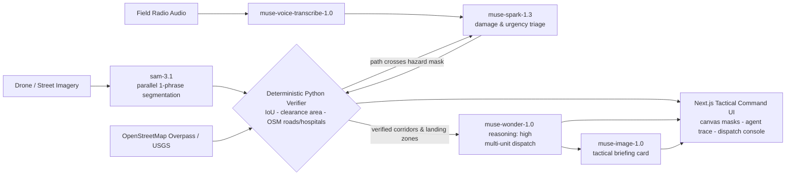

# CrisisGrid — 9-Day Global Frontier Build Plan

> **Event:** Meta Global AI Developer Hackathon — "Push the Frontier"
> **Window:** Oct 27 – Nov 4, 2026 (9 days) · **Demo Day:** Nov 4, 2026
> **Stack (strict):** Meta Model API only (`https://api.meta.ai/v1`, single `MODEL_API_KEY`) + free local Python verification + free OpenStreetMap Overpass / USGS APIs. No paid external APIs. No third-party cloud GPU providers.

## Vision in One Line

CrisisGrid ingests disaster imagery + field radio voice, segments hazards vs. passable infrastructure with `sam-3.1`, **mathematically verifies** evacuation corridors and landing zones in deterministic Python, and autonomously dispatches multi-unit rescue protocols with `muse-wonder-1.0` — with a fully auditable agent trace.

## Architecture at a Glance

---

## Day 1 — Oct 27: Repo Setup & API Smoke Test

- [x] Repo setup: `backend/` FastAPI + `frontend/` Next.js Neo-Brutalist Tactical Command UI shell
- [x] `AGENTS.md` (Meta Model API rules, verifiable-agent principle) and this `ROADMAP.md`
- [x] `.env.example` (`MODEL_API_KEY` only) + `.gitignore`
- [x] `backend/test_meta_api.py` — offline `sam-3.1` wire-format parser self-test, env check, optional `--live` pings
- [x] `backend/services/sam_parser.py` — deterministic regex parser for `<|box;...|><|mask;...|>` output
- [x] FastAPI `GET /health` + `GET /api/config/status` (reports key configured — never the key)
- [x] Frontend shell: header, status strip, canvas / trace / dispatch placeholders in tactical style

**Acceptance:** `python backend/test_meta_api.py` passes offline; with a key, `--live` reaches `muse-spark-1.3`; `uvicorn backend.main:app` serves `/health`; `npm run dev` renders the command shell.

## Day 2 — Oct 28: Parallel Hazard Segmentation

- [x] `backend/services/sam_hazard_scanner.py` — parallel async `sam-3.1`, **one noun phrase per request**
  - Passable Infrastructure: `road`, `bridge`, `clear flat ground`, `rooftop`
  - Critical Hazards: `flood water`, `debris`, `fire`, `damaged building`, `stranded vehicle`
- [x] Normalise boxes/masks to image coordinates; per-class overlays defined (green passable / red hazard; canvas rendering lands Day 6)
- [x] `POST /api/scan-hazards` + alias `POST /api/scan` (image upload → segmentation payload for the canvas); `GET /api/scan-hazards/concepts`

**Acceptance:** One image returns all 9 concept layers; per-concept latency and box/mask counts visible in the trace.

## Day 3 — Oct 29: Voice Radio + Multimodal Triage

- [x] `backend/services/voice_and_triage.py` — `muse-voice-transcribe-1.0` via `POST /v1/asr/transcribe` (multipart, `ENDPOINTING`, WAV)
- [x] Clean text-input fallback for browser testing without audio (`text` form field / `POST /api/triage/text`)
- [x] `muse-spark-1.3` (prefer `developer` role) multimodal damage & urgency assessment fusing transcript + image + mask-stripped segmentation summary; structured JSON priorities + candidate corridor/landing-zone coordinates (normalized 0-1, always `unverified_candidate`)
- [x] `POST /api/triage` (audio **or** text + `scan_json`/`scan_id` + optional image → triage assessment) and `POST /api/triage/text`; WAV contract enforced locally (mono s16le, 16000/24000 Hz - live-probed)

**Acceptance:** A spoken or typed field report produces a structured urgency assessment grounded in the Day 2 scan.

## Day 4 — Oct 30: Verifiable Corridor Engine (Trust Layer)

- [x] `backend/services/verifiable_corridor_engine.py` — deterministic Python verifier
  - [x] Hazard-to-road intersection (IoU) between proposed corridors and hazard masks (mask IoU when SAM RLE decodes; exact bbox geometry otherwise, declared in trace)
  - [x] Minimum safe clearance area check for drone / helicopter landing zones (image-space pixels; no invented metres)
  - [x] OpenStreetMap Overpass emergency-facility lookup (hospital/clinic/doctors/fire/police; queried only with real lat/lon, context only)
- [x] Feedback loop: hazard intersection > 10% (or support/clearance failure) rejects the candidate and forces a bounded `muse-spark-1.3` re-route, logged in the trace; verifier re-checks every revision
- [x] `POST /api/verify` (+ `GET /api/verify/readiness`): proposed corridor / landing zone → `verified | rejected | partially_verified` + geometric proof; only verified candidates are `dispatch_ready`

**Acceptance:** A deliberately hazard-crossing route is rejected with IoU evidence; a clear route is verified with clearance numbers. No model call inside the geometry code.

## Day 5 — Oct 31: Autonomous Dispatch Commander

- [x] `backend/services/wonder_commander.py` — `muse-wonder-1.0` with `reasoning={"effort": "high"}`
- [x] Input: **verified** corridors / landing zones + triage urgency only → multi-unit dispatch protocol (medical, heavy debris clearance, aerial drop); every candidate re-gated deterministically (verification record + hazard ratio ≤ 10%) before Wonder sees it
- [x] Deterministic guardrail after Wonder: units aimed at unverified/rejected candidate IDs are HELD (yellow), never dispatched (green); duplicate unit IDs renamed, taskless units held
- [x] `muse-image-1.0` visual tactical field briefing card generator (`client.images.generate(..., output_format="png")`) — prompt assembled by Python from verified facts only; failure degrades to `status: failed`, never a fabricated card
- [x] `POST /api/dispatch` (verified state → dispatch protocol + briefing card) + `GET /api/dispatch/readiness`
- [x] `POST /api/run-crisisgrid` — unified pipeline: scan → triage → verify → dispatch in one call, concatenated Verifiable Agent Trace

**Acceptance:** One verified scenario yields a coherent multi-unit protocol and a briefing card that invents no unverified facts.
**Proven live (Oct 31):** `live-flood.jpg` + field report -> Spark's first corridor-1 was rejected (hazard crossing), re-routed, and verified by deterministic Python -> `muse-wonder-1.0` issued "Urban Flood Verified Dry Foreground Response" (5 units, all on verified corridor-1 / landing-zone-1, 0 held) -> `muse-image-1.0` briefing card (`live-flood-briefing-card.png`) with no unverified facts invented.

## Day 6 — Nov 1: Tactical Command Frontend

- [x] Interactive HTML5 Canvas (`frontend/components/TacticalCanvas.tsx`) overlaying source imagery with `sam-3.1` detections (translucent fill + thick border + label chip; live SAM mask payload is opaque vendor RLE, so the bounding box is the faithful overlay), Spark candidate corridors (polylines) and landing zones (circles), coloured strictly by verifier state - green verified/passable, red hazard/rejected, yellow dashed unverified - with per-concept layer toggles, click-to-inspect details and hover coordinates
- [x] Live **Verifiable Agent Trace** panel (`frontend/components/AgentTrace.tsx`) merging scan -> triage -> verify -> dispatch events in order, with state filters (verified/rejected/caution counts), auto-scroll and latency/concept metadata - every proposal, verification, rejection and forced re-route readable with its reason
- [x] **Dispatch Action Console** (`frontend/components/DispatchConsole.tsx`): STEP 4 button gated on `dispatch_ready`, `muse-wonder-1.0` unit table (dispatched green / guardrail-held yellow with stripped requested targets), phases, safety brief, deterministic guardrail audit, dispatch basis (verified vs excluded IDs) and the `muse-image-1.0` briefing card rendered inline (honest failure text, never a fabricated card)
- [x] High-contrast Neo-Brutalist tactical styling throughout (`frontend/app/globals.css` Day 6 additions); labelled, keyboard-accessible controls (buttons, checkboxes, file inputs, canvas with aria-label + live status line)
- [x] Mission Control (`frontend/app/page.tsx`): drag-drop image upload, text-fallback field report, WAV radio upload, optional lat/lon for OSM, staged STEP 1-4 buttons plus one-click `POST /api/run-crisisgrid`, per-stage status chips, triage summary and verifier verdict panels; re-running an upstream stage clears downstream state so stale verified/dispatch output can never linger

**Acceptance:** A judge can run scan → triage → verify → dispatch entirely from the browser and read *why* each corridor passed or failed.
**Proven (Nov 1):** `npm run build` clean (compiled + type-checked, `/` 11.9 kB); production server and FastAPI backend both return 200 with all Day 6 panels rendered (MISSION CONTROL, TACTICAL MAP, VERIFIABLE AGENT TRACE, DISPATCH ACTION CONSOLE).

## Day 7 — Nov 2: Before/After Delta & Multi-Sector Triage

- [x] Before/After Damage Delta: `backend/services/damage_delta.py:compute_damage_delta` + `POST /api/delta` - greedy per-concept IoU box matching (persistent / new / cleared) between two Day 2 scans; NEW hazards and LOST passable infrastructure render red, CLEARED hazards green, persistent hazards yellow on the Day 6 canvas Delta View (AFTER frame as base image), with per-concept counts + box-area deltas and a deterministic worsened/improved/stable verdict
- [x] Post-clearance verification: `verify_clearance` + `POST /api/delta/verify-clearance` - the SAME candidates are re-checked by the Day 4 deterministic verifier against the AFTER scan only (zero model calls, no Spark re-route in this path); per-candidate before/after status + hazard-ratio changes reported, and the frontend adopts the after-verification as live state only from that verifier output
- [x] Multi-Sector Triage Mode: `rank_sectors` + `POST /api/sectors/rank` - published 0-100 formula (urgency x0.40 + severity max 25 + people max 15 + hazard footprint max 10 + access pressure max 10, blocked sectors scoring highest access pressure) with full per-sector breakdown and deterministic recommended action (dispatch_now / clearance_then_reverify / verify_candidates / propose_candidates / needs_triage_first); frontend sector save/load snapshots feed the ranking
- [x] Frontend (`frontend/components/Day7Panels.tsx`, `frontend/app/page.tsx`): AFTER image upload + scan, delta summary chips and per-concept table, clearance flip table, sector save/load/delete + ranked table; delta and clearance traces stream into the Verifiable Agent Trace

**Acceptance:** Delta view highlights changed hazards; a cleared sector flips from blocked → verified only after re-scan + verifier pass.
**Proven (Nov 2):** `backend/test_damage_delta.py` 24/24 offline (IoU matching, render-kind mapping, blocked->verified flip earned through the real Day 4 verifier, no flip while debris remains, transparent ranking formula); FastAPI smoke: `/api/delta` 200 improved_hazards_cleared, `/api/delta/verify-clearance` 200 cleared_and_verified + dispatch_ready, `/api/sectors/rank` + `/api/delta/readiness` 200, backend `0.7.0-day7`; full regression (meta/sam/voice/verify/wonder) passes; frontend `npm run build` clean (`/` 15.1 kB).

## Day 8 — Nov 3: Global Disaster Presets (1-Click Judge Testing)

- [x] Preset 1 — **Urban Flood Corridor**: Day 5 live-proof frame (`frontend/public/presets/urban-flood.jpg`) + field-radio WAV (`muse-voice-transcribe-1.0`) + text fallback
- [x] Preset 2 — **Earthquake Bridge & Rubble Triage**: aerial scene generated with `muse-image-1.0` (collapsed bridge, rubble, intact rooftop, clear ground - provenance declared in metadata), text field report
- [x] Preset 3 — **Wildfire Evacuation & Helipad Finder**: aerial scene generated with `muse-image-1.0` (fire line, winding road, open helipad field, town rooftops - provenance declared), text field report
- [x] Each preset: imagery + field report + expected-focus concepts + judge hint, loadable in one click - `backend/services/presets.py` catalogue via `GET /api/presets` (+ `/api/presets/{id}`, 404 for unknown), `frontend/components/PresetPanel.tsx` cards with RUN (full live pipeline) and LOAD ONLY; frontend mirrors the catalogue (`frontend/lib/presets.ts`) as offline fallback and refreshes from the API when reachable
- [x] Honesty contract: presets contain inputs only - no pre-baked detections, verifications or dispatch plans; a preset can end rejected / `completed_no_dispatch` like any other input, surfaced through the standard error/alert states

**Acceptance:** All three presets run end-to-end with no file hunting; failures degrade to clear, honest error states.
**Proven (Nov 3):** `backend/test_presets.py` 25/25 (catalogue integrity, asset existence, frontend/backend id parity, provenance declared); live `sam-3.1` scan check on the generated scenes - earthquake: 11 detections (9 damaged building, road, rooftop), wildfire: fire + road detections - so both segment for real at click time (flood proven end-to-end on Day 5); production smoke: backend `0.8.0-day8` `/api/presets` 200 with 3 presets, frontend 200 with preset cards + all 4 preset assets serving 200; `npm run build` clean (`/` 16.8 kB). Full-pipeline preset runs remain live judge actions (minutes per run, real Meta calls).

## Day 9 — Nov 4: Ship It

- [x] Public GitHub README (problem, architecture, Meta models used, verification principle, quick start)
- [x] Mermaid architecture diagram (kept in sync with this file)
- [x] 3-minute demo video script: disaster in → verified corridor → autonomous dispatch out
- [x] Final pass: `python backend/test_meta_api.py --live`, fresh-clone quick-start check, secrets scan

**Acceptance:** A stranger can clone, add `MODEL_API_KEY`, and reproduce the demo in under 10 minutes.

---

## Model Usage Map (Meta Model API Only)

| Capability | Model | Endpoint / Call | Day |
|---|---|---|---|
| Hazard & infrastructure segmentation | `sam-3.1` | `client.responses.create` (1 noun phrase / request, parallel) | 2 |
| Field radio transcription | `muse-voice-transcribe-1.0` | `POST /v1/asr/transcribe` (multipart) | 3 |
| Damage & urgency triage, corridor proposals | `muse-spark-1.3` | `client.responses.create` / `chat.completions` (`developer` role) | 3-4 |
| Corridor & landing-zone verification | *Local Python + OSM/USGS* | deterministic IoU / clearance math | 4 |
| Multi-unit dispatch protocol | `muse-wonder-1.0` | `client.responses.create(..., reasoning={"effort": "high"})` | 5 |
| Tactical briefing card | `muse-image-1.0` | `client.images.generate(..., output_format="png")` | 5 |

## Risks & Mitigations

- **SAM output format drift** → deterministic regex parser with offline fixtures (`test_meta_api.py`); fail loudly, never guess.
- **Unverified route presented as safe** → verifier is the only component allowed to mark a corridor `verified`; UI renders unverified proposals in yellow, never green.
- **No microphone / audio in demo env** → text-input fallback for field reports (Day 3).
- **API key unavailable during judging** → offline parser self-test + preset trace playback must still demonstrate the verification logic honestly, labelled as replay.
