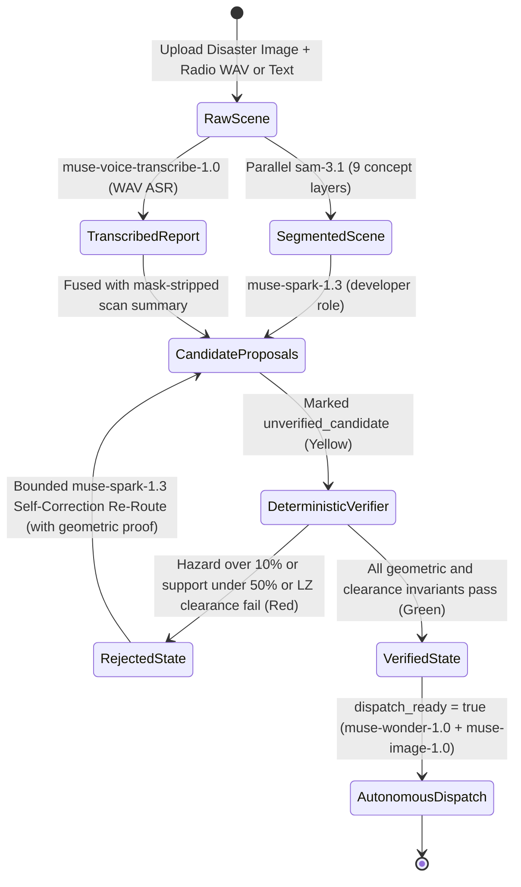

# CrisisGrid — Technical Architecture & Verification Specification

> **Binding Reference:** See [`../AGENTS.md`](../AGENTS.md) for non-negotiable Meta Model API rules and [`../ROADMAP.md`](../ROADMAP.md) for the 9-day build plan.

## 1. Design Philosophy: Neural Proposals, Deterministic Proofs

Emergency response software cannot rely on raw LLM coordinate guesses. Vision-language models excel at high-level semantic synthesis (understanding a panicked radio call and identifying general regions of interest), but they do not reliably compute pixel-level polygon intersections.

CrisisGrid separates **semantic perception & reasoning** (`sam-3.1`, `muse-voice-transcribe-1.0`, `muse-spark-1.3`, `muse-wonder-1.0`, `muse-image-1.0`) from **geometric safety verification** (`verifiable_corridor_engine.py`):



---

## 2. Stage-by-Stage Technical Specification

### 2.1 Stage 1 — Deterministic `sam-3.1` Wire Parser (`backend/services/sam_parser.py`)

`sam-3.1` returns spatial detections in `output_text` using a compact wire grammar:

```text
<0f>0<|box;x1=181;y1=365;x2=556;y2=486;w=1516;h=1600|><|mask;x=0;y=0;data=...|><0f>1<|box;...|><|mask;...|>
```

- **Zero-LLM Parsing:** `parse_sam_output(raw)` uses a compiled regular expression (`_DETECTION_RE`) to extract `(index, x1, y1, x2, y2, w, h, mask_x, mask_y, mask_data)` in $O(N)$ time with zero network or model calls.
- **Coordinate Normalization:** Pixel coordinates $(x_1, y_1, x_2, y_2)$ are normalized against the SAM-declared frame dimensions $(w, h)$ into $[0, 1]^2$ so downstream triage and verification operate independent of input resolution.

### 2.2 Stage 2 — Parallel Single-Phrase Hazard Scanner (`backend/services/sam_hazard_scanner.py`)

- **One-Noun-Phrase Rule:** Per official `sam-3.1` specification, packing multiple concepts into a single prompt degrades segmentation recall. `scan_hazards()` validates every concept via `validate_concepts()` (rejecting commas, semicolons, newlines, or empty strings) and dispatches **one asynchronous `client.responses.create` call per concept** via `asyncio.gather`.
- **Canonical 9-Concept Vocabulary:**
  - **Critical Hazards (`#FF2D20`):** `"flood water"`, `"debris"`, `"fire"`, `"damaged building"`, `"stranded vehicle"`
  - **Passable Infrastructure (`#00C853`):** `"road"`, `"bridge"`, `"clear flat ground"`, `"rooftop"`
- **Per-Concept Failure Isolation:** If one concept request times out or errors upstream, the remaining 8 concept layers still resolve (`status: "partial"`), and the exact failure is logged in the auditable `trace`.

### 2.3 Stage 3 — Voice Radio ASR & Multimodal Triage (`backend/services/voice_and_triage.py`)

1. **Deterministic WAV Contract Validation (`validate_wav_for_asr`):**
   Before calling `POST https://api.meta.ai/v1/asr/transcribe`, CrisisGrid parses the RIFF/WAVE header using Python's standard `wave` module and enforces:
   - Mono channel (`channels == 1`)
   - 16-bit signed little-endian PCM (`bits_per_sample == 16`)
   - Sample rate $\in \{16000, 24000\}\text{ Hz}$
   - File size $\le 25\text{ MB}$
2. **Mask-Stripped Grounding (`summarize_scan`):**
   Raw `sam-3.1` RLE mask strings can be tens of kilobytes per detection. Sending raw RLE strings to an LLM wastes context tokens and encourages hallucination. `summarize_scan()` strips all `mask.data` payloads and constructs a compact, deterministic JSON summary containing normalized bounding boxes (`bbox_xyxy_norm`), area fractions, and detection counts per concept.
3. **Structured Triage (`muse-spark-1.3` with `role="developer"`):**
   `muse-spark-1.3` fuses the radio transcript, optional disaster image, and mask-stripped scan summary into a validated `TriageAssessment` Pydantic model. Every proposed corridor and landing zone is forcibly tagged:
   ```json
   {
     "status": "unverified_candidate",
     "color": "#FFD600",
     "coordinate_space": "normalized_image_0_1",
     "requires_day4_verification": true
   }
   ```

### 2.4 Stage 4 — Deterministic Corridor & Landing-Zone Verifier (`backend/services/verifiable_corridor_engine.py`)

All geometric verification runs locally in pure Python (`model_calls_in_geometry = 0`).

#### A. Dual-Resolution Geometry (Mask IoU vs. Exact BBox Clipping)

- **Mask Mode (`method: "mask"`):** When `sam-3.1` RLE payloads decode via our deterministic integer/COCO run-length decoders (`decode_sam_mask`), the verifier rasterizes candidate polylines (with normalized half-width buffer $b = 0.01$) and circular landing zones onto the $(W, H)$ pixel grid and computes exact pixel-level intersections and IoU.
- **Exact Bounding-Box Mode (`method: "bbox"`):** When a mask payload uses an opaque vendor stream, the verifier analytically clips each polyline segment $\overline{P_i P_{i+1}}$ against each detection's normalized bounding box $[x_1, y_1, x_2, y_2]$ using exact parametric segment-box clipping (`segment_box_intersection_length`) and logs `mask_fallback_reason` in the trace.

#### B. Corridor Verification Equations

Given a candidate polyline $C = (P_0, P_1, \dots, P_k)$ of total Euclidean length $L(C) = \sum_{i=0}^{k-1} \|P_{i+1} - P_i\|_2$, hazard set $\mathcal{H}$, and safe-zone set $\mathcal{S}$:

1. **Hazard Intersection Ratio:**
   $$R_{\text{hazard}}(C) = \frac{L(C \cap \bigcup_{h \in \mathcal{H}} h)}{L(C)}$$
   - **Rule:** If $R_{\text{hazard}}(C) > 0.10$ ($10\%$), the corridor is **REJECTED** (`status: "rejected"`, `color: "#FF2D20"`, `requires_reroute: true`).
2. **Safe-Infrastructure Support Ratio:**
   $$R_{\text{support}}(C) = \frac{L(C \cap \bigcup_{s \in \mathcal{S}} s)}{L(C)}$$
   - **Rule:** If $\mathcal{S} \neq \emptyset$ and $R_{\text{support}}(C) < 0.50$ ($50\%$), the corridor is **REJECTED** for leaving passable infrastructure.

#### C. Landing-Zone Verification Equations

Given a candidate circular landing zone $Z(c, r)$ with center $c = (x_c, y_c) \in [0, 1]^2$, normalized radius $r$, and image dimensions $(W, H)$:

1. **Minimum Pixel Clearance:**
   $$r_{\text{min}} = \begin{cases} 0.015 & \text{if zone\_kind} = \text{drone} \\ 0.040 & \text{if zone\_kind} = \text{helicopter} \end{cases}, \qquad r_{\text{px}} = r \cdot \min(W, H)$$
   - **Rule:** Requires $r \ge r_{\text{min}}$, $R_{\text{hazard}}(Z) \le 0.10$, and safe-surface overlap $R_{\text{surface}}(Z) \ge 0.50$.

#### D. OpenStreetMap Overpass Contextual Enrichment

When real geographic coordinates (`latitude`, `longitude`) are supplied to `POST /api/verify`, `query_emergency_facilities()` queries `https://overpass-api.de/api/interpreter` for `amenity ∈ {hospital, clinic, doctors, fire_station, police}` within `facility_radius_m` (default $5000\text{ m}$) and ranks results by exact Haversine distance:

$$d = 2 R_{\oplus} \arcsin\left(\sqrt{\sin^2\left(\frac{\Delta\phi}{2}\right) + \cos\phi_1\cos\phi_2\sin^2\left(\frac{\Delta\lambda}{2}\right)}\right)$$

Image-normalized coordinates are **never** conflated with GPS coordinates; if `latitude`/`longitude` are omitted, Overpass is not queried (`status: "not_queried"`).

#### E. Bounded Self-Correction Loop (`run_verification_loop`)

When `auto_correct=True` and one or more candidates are rejected, `run_verification_loop()` invokes `muse-spark-1.3` (`role="developer"`) up to `max_correction_attempts` (default `2`) times. The prompt includes:
- The exact rejection reasons and intersecting hazard bounding boxes for each failed candidate.
- The coordinates of segmented safe zones (`road`, `bridge`, `clear flat ground`, `rooftop`).
- Strict instructions to return revised coordinates avoiding the hazard boxes.

Every revised proposal is re-verified from scratch by `verify_candidates()` in pure Python. The model never grades its own homework.

---

### 2.5 Stage 5 — Autonomous Dispatch & Tactical Briefing (`backend/services/wonder_commander.py`)

1. **Pre-Prompt Deterministic Gate (`extract_dispatchable_state`):**
   Re-validates every candidate corridor and landing zone in pure Python before calling `muse-wonder-1.0`. Only candidates carrying a verification record with `status == "verified"` and `hazard_intersection_ratio <= 0.10` enter the prompt as dispatchable geometry; rejected candidate IDs are listed strictly as excluded. If zero candidates are verified, `NoDispatchableCandidatesError` is raised and `muse-wonder-1.0` is never called.
2. **High-Effort Orchestration (`muse-wonder-1.0`):**
   Called via `client.responses.create(model="muse-wonder-1.0", reasoning={"effort": "high"}, input=[...])` (`role="developer"`).
3. **Post-Wonder Deterministic Guardrail (`sanitize_dispatch_plan`):**
   Validates every unit assignment in the returned `WonderDispatchPlan`:
   - Units targeting a verified corridor or landing-zone ID are marked `status: "dispatched"` (`#00C853` Green).
   - Any unit targeting an unverified/rejected ID (or lacking a concrete task) is forcibly **HELD** (`status: "held_unverified_target"`, `#FFD600` Yellow) with `target_candidate_id` stripped to `None` and the original requested target recorded in `requested_target_candidate_id` for audit transparency.
4. **Facts-Only Tactical Briefing Card (`muse-image-1.0`):**
   `build_briefing_card_prompt()` constructs a deterministic prompt from verified corridor names, verified LZ clearances, and dispatched unit counts—never mentioning rejected candidate IDs—and calls `client.images.generate(model="muse-image-1.0", prompt=..., output_format="png")`.

### 2.6 Stage 6 — Damage Delta, Post-Clearance Flip & Multi-Sector Ranking (`backend/services/damage_delta.py`)

All three Day 7 capabilities execute in pure local Python (`model_calls = 0`):

1. **Before/After Damage Delta (`compute_damage_delta`):**
   Matches detections per concept across `scan_before` and `scan_after` using greedy bounding-box IoU ($\ge 0.10$), classifying detections as `persistent`, `new`, or `cleared` (`lost` for safe infrastructure).
2. **Post-Clearance Re-Verification (`verify_clearance`):**
   Re-runs `verify_candidates()` on the post-clearance scan (`scan_after`). A previously blocked route flips from `rejected` $\rightarrow$ `verified` **only** by passing the Day 4 geometric invariants on the new scan.
3. **Multi-Sector Priority Formula (`rank_sectors`):**
   Scores each sector on $[0, 100]$:
   $$\text{Score} = 0.40 \cdot \text{Urgency} + \text{Severity}_{\le 25} + \text{PeopleAtRisk}_{\le 15} + \text{HazardFootprint}_{\le 10} + \text{AccessPressure}_{\le 10}$$

